# Implementation Plan: Fleet Services & Wishlist Modules Architecture

This implementation plan translates the handwritten **Technical Agenda** into modular, declarative NixOS, nix-darwin, and Home Manager modules across the fleet.

---

## 1. Goal Description

Build a cohesive, production-grade library of declarative modules in `~/src/infra` addressing every item from the handwritten technical wishlist:
1. **Userspace & Client Workflow**: FOSS alternatives to 1Password & AdGuard, automated Git repository synchronization on directory switch, Firefox sync, and hardware security keys.
2. **Filesystem & Storage Architecture**: Optimized storage configurations (Btrfs subvolumes for Nix store, XFS/EXT4, Disko layouts), and BorgBackup automation.
3. **Self-Hosted Infrastructure Services**: Centralized homelab services (Vaultwarden, Nextcloud, Forgejo git forge, Paperless-ngx, SilverBullet wiki, Memos, RustDesk, NUT power monitoring).
4. **Media & Life Management**: Immich (photos), Jellyfin (video), Navidrome (music), Home Assistant (smart home), Miniflux (RSS), and project trackers (Planka / Taiga).
5. **Game Server Orchestration**: Pelican / Pterodactyl daemon with profiles for Minecraft, Terraria, and Palworld.

---

## 2. User Review Required

> [!IMPORTANT]
> **Branch Strategy**:
> We will create and switch to a dedicated feature branch:
> `feat/fleet-services-expansion`
> All new module templates and services will be developed here, keeping `master` completely stable.

> [!NOTE]
> **Architectural Separation**:
> Workstation nodes (`308-222242`, `308-225660`) should not run all server services locally. We will structure the server services as toggleable modules in `modules/nixos/services/` (e.g. `services.fleet.vaultwarden.enable = true;`) so they can be assigned to dedicated server nodes or spun up on demand.

---

## 3. Wishlist Transcription & Categorization

The handwritten Technical Agenda maps directly to the following modular layers:

```mermaid
flowchart TD
    subgraph Client ["Phase 1: Client & Workflow"]
        A1["Bitwarden / Vaultwarden & KeepassXC"]
        A2["FOSS Adblocking (AdGuard Home / Brave / Librewolf)"]
        A3["Git Directory Hook (Auto-fetch/rebase prompt)"]
        A4["Nordic Security Keys (FIDO2 / U2F)"]
        A5["RustDesk Remote Access Client"]
    end

    subgraph Storage ["Phase 2: Storage & Resiliency"]
        B1["Disko Btrfs Layout (Nix Store deduplication + Subvolumes)"]
        B2["BorgBackup (Client & Server fleet backups)"]
        B3["NUT (Network UPS Tools) Power Management"]
        B4["Bcachefs / XFS / MDADM Evaluation"]
    end

    subgraph CoreCloud ["Phase 3: Self-Hosted Core Cloud"]
        C1["Vaultwarden (Password Server)"]
        C2["Forgejo (Git Server)"]
        C3["SilverBullet / Memos (Wiki & Notes)"]
        C4["Paperless-ngx (Document Archival)"]
        C5["Nextcloud (Unified Suite Evaluation)"]
    end

    subgraph Media ["Phase 4: Home & Media Hub"]
        D1["Immich (Photo Management with ML)"]
        D2["Jellyfin (Hardware-Accelerated Video)"]
        D3["Navidrome (Music Streaming)"]
        D4["Home Assistant (IoT Automation)"]
        D5["Miniflux (Minimalist RSS)"]
        D6["Cockpit (Web GUI System Admin)"]
    end

    subgraph Gaming ["Phase 5: Game Servers"]
        E1["Pelican / Pterodactyl Panel & Wings"]
        E2["Dedicated Game Profiles (Minecraft, Terraria, Palworld)"]
    end

    Client --> Storage --> CoreCloud --> Media --> Gaming
```



---

## 4. Phased Implementation Strategy

### Phase 1: Client Workflow & FOSS Replacements (Workstations & Mac)
* **Goal**: Replace proprietary tools and streamline developer muscle memory across macOS and Linux.
* **Modules to build**:
  * `modules/shared/security/vaultwarden-client.nix`: Configure Bitwarden CLI (`rbw` or `bitwarden-cli`) and KeePassXC.
  * `home/programs/git-sync.nix`: Implement the requested Zsh hook:
    * When switching into a git repository directory (`chpwd` hook), run a silent `git fetch`.
    * If remote is ahead and working tree is clean, prompt: *"Upstream has changes. Rebase now? [y/N]"* and run `git pull --rebase`.
  * `modules/shared/security/yubikey-nordic.nix`: Setup U2F/FIDO2 hardware key authentication rules (PAM + udev).
  * `modules/shared/remote/rustdesk.nix`: Package/configure RustDesk remote client.

### Phase 2: Storage, Disko & Backups
* **Goal**: Establish rock-solid, snapshot-enabled storage and power protection.
* **Modules to build**:
  * `modules/nixos/hardware/disko-btrfs.nix`: Declarative Disko layout using Btrfs subvolumes (`@root`, `@nix`, `@home`, `@snapshots`, `@swap`) with zstd compression to maximize Nix store speed and deduplication.
  * `modules/nixos/services/backup-borg.nix`: Declarative BorgBackup jobs targeting local NAS shares or remote repositories with Age-encrypted credentials.
  * `modules/nixos/services/nut.nix`: Network UPS Tools (NUT) monitoring daemon for battery backup telemetry and automated graceful shutdown.

### Phase 3: Core Homelab Cloud & Productivity Services
* **Goal**: Enable self-hosted infrastructure services.
* **Modules to build**:
  * `modules/nixos/services/vaultwarden.nix`: Lightweight Bitwarden-compatible password vault.
  * `modules/nixos/services/forgejo.nix`: Lightweight, FOSS Git software forge (Codeberg's engine).
  * `modules/nixos/services/silverbullet.nix`: Extensible markdown-based knowledge base and wiki.
  * `modules/nixos/services/memos.nix`: Privacy-first, lightweight note-taking service.
  * `modules/nixos/services/paperless.nix`: Document scanner & OCR archival with automatic classification.
  * `modules/nixos/services/nextcloud.nix`: Full collaboration suite configuration (file sync, calendars, contacts).

### Phase 4: Media, Home Automation & Network Defense
* **Goal**: Entertainment, IoT, and network-wide protection.
* **Modules to build**:
  * `modules/nixos/services/adguard-home.nix` & `pihole.nix`: DNS-level adblocking and query filtering.
  * `modules/nixos/services/immich.nix`: High-performance self-hosted photo/video backup with machine-learning facial recognition.
  * `modules/nixos/services/jellyfin.nix`: Media streaming server with VAAPI/QuickSync transcoding.
  * `modules/nixos/services/navidrome.nix`: Lightweight Subsonic-compatible music server.
  * `modules/nixos/services/home-assistant.nix`: Local smart home orchestration.
  * `modules/nixos/services/miniflux.nix`: Fast, minimalist RSS reader.
  * `modules/nixos/services/cockpit.nix`: Web-based graphical Linux system administration.
  * `modules/nixos/services/project-tracker.nix`: Planka / Taiga kanban board service.

### Phase 5: Game Server Orchestration
* **Goal**: Scalable hosting for multiplayer game servers.
* **Modules to build**:
  * `modules/nixos/services/game-servers/pelican.nix`: Pelican Panel and Wings daemon (the next-generation successor to Pterodactyl).
  * Standalone service modules for lightweight native hosting:
    * `minecraft.nix` (Paper / Fabric)
    * `terraria.nix` (tShock)
    * `palworld.nix` (SteamCMD headless container)

---

## 5. Verification Plan

### Automated Build Verification
After each module is created, verify evaluation and syntax without deploying:
```bash
nix eval --impure --expr 'let flake = builtins.getFlake (toString ./src/infra); in [ flake.darwinConfigurations."308-225660".config.system.build.toplevel.drvPath flake.nixosConfigurations."308-222242".config.system.build.toplevel.drvPath ]'
```

### Manual Verification
1. Test the Git `chpwd` auto-rebase prompt in an interactive Zsh session.
2. Validate Bitwarden CLI authentication and hardware key enrollment.
3. Test spin-up of containerized services (Vaultwarden, Immich, Navidrome) in the local `308-225660NixOSVM` sandbox before promoting to bare-metal nodes.
