# Implementation Plan: Fleet Services & Wishlist Modules Architecture

This implementation plan translates the handwritten **Technical Agenda** into modular, declarative NixOS, nix-darwin, and Home Manager modules across the fleet.

---

## 1. Goal Description

Build a cohesive, production-grade library of declarative modules in `~/src/infra` addressing every item from the handwritten technical wishlist:
1. **Userspace & Client Workflow**: FOSS alternatives to 1Password & AdGuard, automated Git repository synchronization on directory switch, Firefox sync, and hardware security keys.
2. **Filesystem & Storage Architecture**: Optimized storage configurations (Btrfs subvolumes for Nix store, XFS/EXT4, Disko layouts), and BorgBackup automation.
3. **Self-Hosted Infrastructure Services**: Centralized homelab services (Vaultwarden, Nextcloud, Forgejo git forge, Paperless-ngx, SilverBullet wiki, Memos, RustDesk, NUT power monitoring).
4. **Media & Life Management**: Immich (photos), Jellyfin (video), Navidrome (music), Home Assistant (smart home), Miniflux (RSS), and project trackers (Planka / Taiga).
5. **Game Server Orchestration**: Pelican / Pterodactyl daemon with profiles for Minecraft, Terraria, and Palworld.

---

## 2. User Review Required

> [!CRITICAL]
> **🔥 PRIORITY #1 FOUNDATION: RE-INITIALIZE SOPS / AGE SECRETS FROM SCRATCH**
> Because legacy `.sops.yaml` keys were lost, **cryptographic trust must be established first**.
> Before provisioning or launching dependent cloud services (Vaultwarden, Borg backups, Nextcloud, Forgejo), we must generate pristine Age keypairs, configure `.sops.yaml`, and re-initialize encrypted secrets. This safeguards against storing sensitive credentials in plaintext anywhere in the repository.
> See [**`docs/sops-bootstrap-runbook.md`**](./sops-bootstrap-runbook.md) & [`scripts/bootstrap-sops-keys.sh`](../scripts/bootstrap-sops-keys.sh).

> [!IMPORTANT]
> **Branch Strategy**:
> We will create and switch to a dedicated feature branch:
> `feat/fleet-services-expansion`
> All new module templates and services will be developed here, keeping `master` completely stable.

> [!NOTE]
> **Architectural Separation**:
> Workstation nodes (`308-222242`, `308-225660`) should not run all server services locally. We will structure the server services as toggleable modules in `modules/nixos/services/` (e.g. `services.fleet.vaultwarden.enable = true;`) so they can be assigned to dedicated server nodes or spun up on demand.

---

## 3. Wishlist Transcription & Categorization

The handwritten Technical Agenda maps directly to the following modular layers:

```mermaid
flowchart TD
    subgraph Client ["Phase 1: Client & Workflow"]
        A1["Bitwarden / Vaultwarden & KeepassXC (Done)"]
        A2["FOSS Adblocking (AdGuard Home / Pi-hole) (Done)"]
        A3["Git Directory Hook (Auto-fetch/rebase prompt) (Done)"]
        A4["Nordic Security Keys (FIDO2 / U2F) (Done)"]
        A5["RustDesk Remote Access Client (Done)"]
    end

    subgraph Storage ["Phase 2: Storage & Resiliency"]
        B1["Disko Btrfs Layout (Nix Store deduplication + Subvolumes) (Done)"]
        B2["BorgBackup (Client & Server fleet backups) (Done)"]
        B3["NUT (Network UPS Tools) Power Management (Done)"]
        B4["Bcachefs / XFS / MDADM Evaluation (Done)"]
        B5["File Integrity & Checksum Health Monitor (Bitrot / ISO / Archive verifier) (Done)"]
    end

    subgraph CoreCloud ["Phase 3: Self-Hosted Core Cloud"]
        C1["Vaultwarden (Password Server) (Done)"]
        C2["Forgejo (Git Server & Actions Runner) (Done)"]
        C3["SilverBullet / Memos (Wiki & Notes) (Done)"]
        C4["Paperless-ngx (Document Archival) (Done)"]
        C5["Nextcloud (Unified Suite Evaluation) (Done)"]
    end

    subgraph Media ["Phase 4: Home & Media Hub"]
        D1["Immich (Photo Management with ML) (Done)"]
        D2["Jellyfin (Hardware-Accelerated Video) (Done)"]
        D3["Navidrome (Music Streaming) (Done)"]
        D4["Home Assistant (IoT Automation) (Done)"]
        D5["Miniflux (Minimalist RSS) (Done)"]
        D6["Cockpit (Web GUI System Admin) (Done)"]
    end

    subgraph Gaming ["Phase 5: Game Servers"]
        E1["Pelican / Pterodactyl Panel & Wings (Done)"]
        E2["Dedicated Game Profiles (Minecraft, Terraria, Palworld) (Done)"]
    end

    Client --> Storage --> CoreCloud --> Media --> Gaming
```



---

## 4. Phased Implementation Strategy

### Phase 1: Client Workflow & FOSS Replacements (Workstations & Mac)
* **Goal**: Replace proprietary tools and streamline developer muscle memory across macOS and Linux.
* **Modules built (1-to-1)**:
  * [x] **COMPLETED**: [`modules/shared/security/vaultwarden-client.nix`](../modules/shared/security/vaultwarden-client.nix) & [`modules/shared/security/keepassxc.nix`](../modules/shared/security/keepassxc.nix): Configured Bitwarden CLI (`bw`) and KeePassXC in dedicated 1-to-1 modules.
  * [x] **COMPLETED**: [`home/programs/git-sync.nix`](../home/programs/git-sync.nix): Implemented the requested Zsh hook:
    * When switching into a git repository directory (`chpwd` hook), runs a background `git fetch`.
    * If remote is ahead and working tree is clean, prompts: *"Upstream has changes. Rebase now? [y/N]"* and runs `git pull --rebase`.
  * [x] **COMPLETED**: [`modules/shared/security/yubikey-nordic.nix`](../modules/shared/security/yubikey-nordic.nix) & [`modules/shared/security/gpg.nix`](../modules/shared/security/gpg.nix): Setup U2F/FIDO2 hardware key authentication rules (PAM + udev), GPG signing, OpenSK flasher script (`scripts/flash-nordic-opensk.sh`), and runbook (`docs/hardware_security_keys_runbook.md`).
  * [x] **COMPLETED**: [`modules/shared/remote/rustdesk.nix`](../modules/shared/remote/rustdesk.nix): Packaged/configured RustDesk remote client across Linux and macOS.

### Phase 2: Storage, Disko & Backups
* **Goal**: Establish rock-solid, snapshot-enabled storage and power protection.
* **Modules built (1-to-1)**:
  * [x] **COMPLETED**: [`modules/nixos/hardware/disko-btrfs.nix`](../modules/nixos/hardware/disko-btrfs.nix) & [`modules/nixos/hardware/disko-impermanence.nix`](../modules/nixos/hardware/disko-impermanence.nix): Declarative Disko layouts using Btrfs subvolumes (`@`, `@nix`, `@home`, `@persist`, `@log`) with `zstd` compression, `btrbk` snapshots, and `scrutiny` SMART monitoring.
  * [x] **COMPLETED**: [`modules/nixos/services/backup-borg.nix`](../modules/nixos/services/backup-borg.nix): Declarative BorgBackup jobs targeting local NAS shares or remote repositories with Age/SOPS-encrypted credentials.
  * [x] **COMPLETED**: [`modules/nixos/services/nut.nix`](../modules/nixos/services/nut.nix): Network UPS Tools (NUT) monitoring daemon for battery backup telemetry and automated graceful shutdown.
  * [x] **COMPLETED**: [`modules/shared/storage/file-integrity-monitor.nix`](../modules/shared/storage/file-integrity-monitor.nix): Automated SHA-256 checksum verification & bitrot health monitor (`fim-init`, `fim-verify`, plus scheduled systemd timer / macOS LaunchAgent).

### Phase 3: Core Homelab Cloud & Productivity Services
* **Goal**: Enable self-hosted infrastructure services.
* **Modules built (1-to-1)**:
  * [x] **COMPLETED**: [`modules/nixos/services/vaultwarden.nix`](../modules/nixos/services/vaultwarden.nix): Lightweight Bitwarden-compatible password vault (`127.0.0.1:8222`).
  * [x] **COMPLETED**: [`modules/nixos/services/forgejo.nix`](../modules/nixos/services/forgejo.nix) & [`modules/nixos/services/forgejo-runner.nix`](../modules/nixos/services/forgejo-runner.nix): Lightweight FOSS Git software forge (`:3000`) and CI/CD runner.
  * [x] **COMPLETED**: [`modules/nixos/services/silverbullet.nix`](../modules/nixos/services/silverbullet.nix): Extensible Markdown-based knowledge base and wiki (`:3001`).
  * [x] **COMPLETED**: [`modules/nixos/services/memos.nix`](../modules/nixos/services/memos.nix): Privacy-first, lightweight note-taking service (`:5230`).
  * [x] **COMPLETED**: [`modules/nixos/services/paperless.nix`](../modules/nixos/services/paperless.nix): Document scanner & OCR archival with automatic classification (`:28981`).
  * [x] **COMPLETED**: [`modules/nixos/services/nextcloud.nix`](../modules/nixos/services/nextcloud.nix): Full collaboration suite configuration with Redis caching (`:8084`).

### Phase 4: Media, Home Automation & Network Defense
* **Goal**: Entertainment, IoT, and network-wide protection.
* **Modules built (1-to-1)**:
  * [x] **COMPLETED**: [`modules/nixos/services/adguard-home.nix`](../modules/nixos/services/adguard-home.nix) & [`modules/nixos/services/pihole.nix`](../modules/nixos/services/pihole.nix): DNS-level adblocking and query filtering.
  * [x] **COMPLETED**: [`modules/nixos/services/immich.nix`](../modules/nixos/services/immich.nix): High-performance self-hosted photo/video backup with ML facial recognition (`:2283`).
  * [x] **COMPLETED**: [`modules/nixos/services/jellyfin.nix`](../modules/nixos/services/jellyfin.nix): Media streaming server with VAAPI/QuickSync transcoding (`:8096`).
  * [x] **COMPLETED**: [`modules/nixos/services/navidrome.nix`](../modules/nixos/services/navidrome.nix): Lightweight Subsonic-compatible music server (`:4533`).
  * [x] **COMPLETED**: [`modules/nixos/services/home-assistant.nix`](../modules/nixos/services/home-assistant.nix): Local smart home orchestration (`:8123`).
  * [x] **COMPLETED**: [`modules/nixos/services/miniflux.nix`](../modules/nixos/services/miniflux.nix): Fast, minimalist RSS reader (`:8085`).
  * [x] **COMPLETED**: [`modules/nixos/services/cockpit.nix`](../modules/nixos/services/cockpit.nix): Web-based graphical Linux system administration (`:9090`).
  * [x] **COMPLETED**: [`modules/nixos/services/planka.nix`](../modules/nixos/services/planka.nix): Planka real-time kanban board service (`:3002`), plus [`modules/nixos/services/snipeit.nix`](../modules/nixos/services/snipeit.nix) (`:8081`) and [`modules/nixos/services/zammad.nix`](../modules/nixos/services/zammad.nix) (`:8082`).

### Phase 5: Game Server Orchestration
* **Goal**: Scalable hosting for multiplayer game servers.
* **Modules built (1-to-1)**:
  * [x] **COMPLETED**: [`modules/nixos/services/game-servers/pelican.nix`](../modules/nixos/services/game-servers/pelican.nix): Pelican Panel (`:8086`) and Wings daemon (`:8443`).
  * [x] **COMPLETED**: Standalone 1-to-1 service modules for lightweight native hosting:
    * [`modules/nixos/services/game-servers/minecraft.nix`](../modules/nixos/services/game-servers/minecraft.nix) (`:25565`)
    * [`modules/nixos/services/game-servers/terraria.nix`](../modules/nixos/services/game-servers/terraria.nix) (`:7777`)
    * [`modules/nixos/services/game-servers/palworld.nix`](../modules/nixos/services/game-servers/palworld.nix) (`:8211/udp`)

---

## 5. Verification Plan

### Automated Build Verification
After each module is created, verify evaluation and syntax without deploying:
```bash
nix eval --impure --expr 'let flake = builtins.getFlake (toString ./src/infra); in [ flake.darwinConfigurations."308-225660".config.system.build.toplevel.drvPath flake.nixosConfigurations."308-222242".config.system.build.toplevel.drvPath ]'
```

### Manual Verification
1. Test the Git `chpwd` auto-rebase prompt in an interactive Zsh session.
2. Validate Bitwarden CLI authentication and hardware key enrollment.
3. Test spin-up of containerized services (Vaultwarden, Immich, Navidrome) in the local `308-225660NixOSVM` sandbox before promoting to bare-metal nodes.
