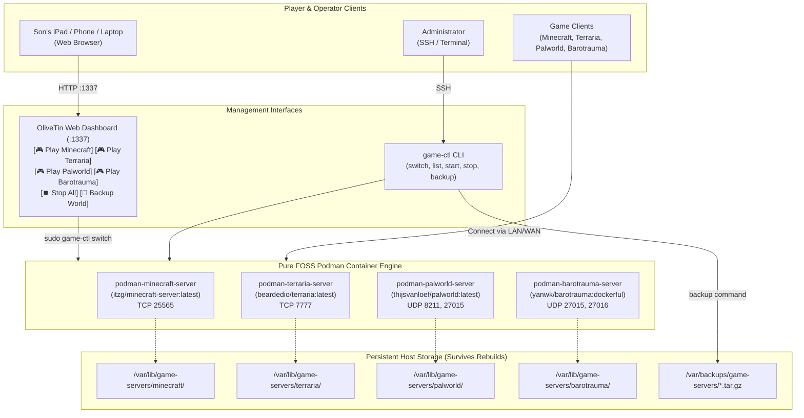

# Operational Runbook: Sandboxed Fleet Game Servers

This guide documents the architecture, kid-friendly operation, modpack management, and disaster recovery procedures for the declarative game server suite hosted on the **Intel NUC 7 (NUC7i7DNFE / `nuc-game01`)**.

---

## 1. System Architecture Overview



---

## 2. Kid-Friendly Operation (OliveTin Web UI)

Your son does **not** need SSH or terminal access to play games. Everything can be controlled from an iPad, iPhone, Android device, or PC browser.

1. Open a browser and navigate to:
   ```
   http://<nuc-ip>:1337
   ```
2. **To Play a Game**:
   - Tap **🎮 Play Minecraft**, **🎮 Play Terraria**, **🎮 Play Palworld**, or **🎮 Play Barotrauma**.
   - **Mutual Exclusion**: Behind the scenes, the system automatically checks if another game server is running and gracefully stops it first. This guarantees that whichever game your son is playing gets **100% of the Intel CPU cores and system RAM**.
3. **To Finish Playing**:
   - Tap **⏹️ Stop All Games** to shut down the server and put the NUC in an idle, low-power state.
4. **To Back Up World Saves**:
   - Tap **💾 Backup [Game] World**. A timestamped `.tar.gz` archive of that world is instantly saved to `/var/backups/game-servers/`.

---

## 3. Minecraft Modpack Guide (Prism Launcher Style)

The Minecraft server uses `itzg/minecraft-server`, which acts like Prism Launcher on the server side. It can automatically download mod loaders (Fabric, Forge, NeoForge, Quilt) and community modpacks directly from Modrinth and CurseForge.

### A. Modrinth Modpacks (e.g. Cobblemon, Better MC, Fabulously Optimized)
1. In your host configuration (`hosts/nixos/nuc-game01/default.nix`), find the `minecraft` block:
   ```nix
   services.fleet.game-servers.minecraft = {
     enable = true;
     autoStart = false;
     memory = "6G"; # Give modpacks 6-8GB of RAM
     modpack = {
       platform = "modrinth";
       slug = "cobblemon"; # Replace with your Modrinth pack slug
     };
   };
   ```
2. Rebuild the NUC:
   ```bash
   sudo nixos-rebuild switch --flake ~/src/infra#nuc-game01
   ```
3. When the server is started via OliveTin or `game-ctl switch minecraft`, the container contacts the Modrinth API, downloads the correct Forge/Fabric loader, downloads all server mods, and launches the modded world.

### B. CurseForge Modpacks (e.g. All The Mods 9)
```nix
services.fleet.game-servers.minecraft = {
  enable = true;
  autoStart = false;
  memory = "8G";
  modpack = {
    platform = "curseforge";
    slug = "all-the-mods-9";
    fileId = "4248390"; # Optional: pin exact version
  };
};
```

### C. Importing an Existing World or Prism Launcher Instance
To copy a local world or custom modpack directly from your computer or Prism Launcher:
1. Copy the world or instance folder to the NUC:
   ```bash
   rsync -avzP ~/PrismLauncher/instances/MyModpack/minecraft/ jchambers@nuc-game01:/var/lib/game-servers/minecraft/
   ```
2. Fix permissions:
   ```bash
   sudo chown -R 1000:1000 /var/lib/game-servers/minecraft
   ```
3. Start the server from OliveTin. The container automatically loads your existing world, player inventory, and coordinates.

---

## 4. Save Persistence & Disaster Recovery

All game states are stored outside of containers on the host filesystem:
- **Minecraft**: `/var/lib/game-servers/minecraft/`
- **Terraria**: `/var/lib/game-servers/terraria/`
- **Palworld**: `/var/lib/game-servers/palworld/`
- **Barotrauma**: `/var/lib/game-servers/barotrauma/`

### Creating an Instant Backup via CLI:
```bash
sudo game-ctl backup minecraft
```
Output:
```
💾 Archiving minecraft save directory...
✅ Backup created successfully: /var/backups/game-servers/minecraft_backup_20261031_144500.tar.gz
```

### Restoring a Backup:
If a world gets corrupted or griefed:
1. Stop the game server:
   ```bash
   sudo game-ctl stop minecraft
   ```
2. Restore the backup archive:
   ```bash
   sudo rm -rf /var/lib/game-servers/minecraft/*
   sudo tar -xzf /var/backups/game-servers/minecraft_backup_<timestamp>.tar.gz -C /var/lib/game-servers/
   sudo chown -R 1000:1000 /var/lib/game-servers/minecraft
   ```
3. Restart the game server:
   ```bash
   sudo game-ctl start minecraft
   ```

---

## 5. Command-Line Reference (`game-ctl`)

Operators have access to `game-ctl`:

| Command | Description |
| :--- | :--- |
| `game-ctl list` | Prints status table of all games (Online/Offline, Unit, Save Path). |
| `game-ctl switch <game>` | Mutual exclusion switch: stops other games and launches `<game>`. |
| `game-ctl start <game>` | Starts the specified server unit. |
| `game-ctl stop <game>` | Stops the specified server unit. |
| `game-ctl stop-all` | Stops all game servers immediately to idle the system. |
| `game-ctl restart <game>` | Restarts the specified server unit. |
| `game-ctl status <game>` | Shows systemd service health and container status. |
| `game-ctl logs <game>` | Streams live server console output in real time. |
| `game-ctl backup <game>` | Creates a timestamped `.tar.gz` archive in `/var/backups/game-servers/`. |

---

## 6. Official Game Ports Summary

Because only one game runs at a time (Mutual Exclusion), each game runs on its **official standard port**, meaning players do not need to type weird port numbers:

| Game | Protocol | Host Port | In-Game Connection |
| :--- | :--- | :--- | :--- |
| **Minecraft** | TCP | `25565` | `nuc-game01.local` (default port) |
| **Terraria** | TCP | `7777` | `nuc-game01.local:7777` (default port) |
| **Palworld** | UDP | `8211`, `27015` | `nuc-game01.local:8211` |
| **Barotrauma** | UDP | `27015`, `27016` | Join via Server Browser or LAN |
| **OliveTin Web UI** | TCP | `1337` | `http://nuc-game01.local:1337` |
