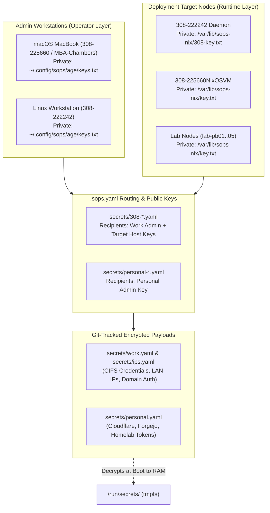

# SOPS & Age Secrets Bootstrap Runbook (`docs/sops-bootstrap-runbook.md`)

> **Roadmap Priority #1 (Ground Zero):** *Re-initialize and integrate declarative SOPS / Age secret management from scratch to safeguard confidential data and establish the fleet trust boundary before provisioning services.*

---

## 1. Executive Summary & Why This Is Priority #1

In declarative systems managed by **NixOS** and **nix-darwin**, all code and files referenced by configuration derivations are compiled into `/nix/store`. **The `/nix/store` is globally readable by any local process or user.** Committing plain text passwords, API keys, or domain credentials into Git or raw Nix expressions creates severe security exposures.

To prevent leaks:
1. Credentials are encrypted at rest using **Mozilla SOPS** and **Age** public-key cryptography.
2. Encrypted YAML files live safely in version control (`secrets/work.yaml`, `secrets/ips.yaml`, and `secrets/personal.yaml`).
3. Decryption occurs strictly at runtime into an in-memory **RAM tmpfs** (`/run/secrets/`), symlinked only to the services that require them with strict `0600` root permissions.

> [!CAUTION]
> **State Assessment & Incident Context:**
> The previous `.sops.yaml` configuration and corresponding Age private keys were lost. As a result, the existing encrypted payloads in `secrets/` cannot be decrypted.
> **All keys and secrets must be re-initialized from scratch.** Establishing this trust foundation is the fleet's **#1 priority** so that district credentials (CIFS storage, domain logins, API tokens) and homelab secrets are never stored or cached in plaintext.

---

## 2. Cryptographic Architecture & Key Hierarchy

We employ a **Zero-Trust, Multi-Recipient Architecture** separating Work (USD 308) from Personal (Homelab) secrets:



### Key Storage Matrix

| Role | Environment | Key File Location | POSIX Permissions | Purpose |
| :--- | :--- | :--- | :--- | :--- |
| **Operator (Work)** | macOS / Linux | `~/.config/sops/age/keys.txt` | `0600` (`-rw-------`) | Editing and authoring `work.yaml` and `ips.yaml` |
| **Operator (Personal)** | macOS / Linux | `~/.config/sops/age/keys.txt` | `0600` (`-rw-------`) | Editing and authoring `personal.yaml` |
| **Work Host (308-222242)** | NixOS Bare-Metal | `/var/lib/sops-nix/308-key.txt` | `0400` (`-r--------`) root | Runtime boot decryption for CIFS mounts |
| **Sandbox VM** | NixOS VM / Lab | `/var/lib/sops-nix/key.txt` | `0400` (`-r--------`) root | Testing container secrets |

---

## 3. Ground-Up Bootstrap Procedure (Step-by-Step)

### Step 1: Install or Verify CLI Tools (`age` & `sops`)
On macOS or Linux, ensure `age`, `age-keygen`, and `sops` are available:
```bash
# If using Nix environment
nix-shell -p age sops

# Or declaratively on macOS via nix-darwin / Home Manager
darwin-rebuild switch --flake ~/src/infra#308-225660
```

### Step 2: Generate New Age Keypairs
Run the automated bootstrap helper:
```bash
chmod +x ~/src/infra/scripts/bootstrap-sops-keys.sh
~/src/infra/scripts/bootstrap-sops-keys.sh work
```

*Or manually:*
```bash
# 1. Create secure config directory
mkdir -p ~/.config/sops/age
chmod 0700 ~/.config/sops/age

# 2. Generate private key file
age-keygen -o ~/.config/sops/age/keys.txt
chmod 0600 ~/.config/sops/age/keys.txt

# 3. View the newly generated public key:
age-keygen -y ~/.config/sops/age/keys.txt
# Output: age1xxxxxxxxxxxxxxxxxxxxxxxxxxxxxxxxxxxxxxxxxxxxxxxxxxxxxxxxxx
```

> [!CRITICAL]
> **Step 2B: Offline Disaster Recovery Backup (Mandatory Before Proceeding):**
> Before encrypting any data with the new key, copy the contents of `~/.config/sops/age/keys.txt` and store it in an encrypted offline vault (such as 1Password, Bitwarden, or a physical encrypted USB drive).
> If this private key is lost again, all newly encrypted secrets will be permanently unrecoverable.

---

### Step 3: Configure `.sops.yaml` with New Public Keys

Update `~/src/infra/.sops.yaml` with the public key(s) generated in Step 2:

```yaml
creation_rules:
  # ----------------------------------------------------------------------------
  # 1. USD 308 School District Secrets Routing
  # ----------------------------------------------------------------------------
  - path_regex: secrets/308-.*\.yaml$
    key_groups:
      - age:
          - "<PASTE_NEW_WORK_PUBLIC_AGE_KEY_HERE>"

  # ----------------------------------------------------------------------------
  # 2. Personal / Homelab Secrets Routing
  # ----------------------------------------------------------------------------
  - path_regex: secrets/personal-.*\.yaml$
    key_groups:
      - age:
          - "<PASTE_NEW_PERSONAL_PUBLIC_AGE_KEY_HERE>"
```

---

### Step 4: Re-Initialize Clean Secret Payloads

Because the old keys were lost, delete the unreadable legacy files and create fresh, valid encrypted templates:

#### 1. USD 308 District Secrets:
```bash
# Export the SOPS age key path
export SOPS_AGE_KEY_FILE="$HOME/.config/sops/age/keys.txt"

# Re-initialize the file with clean schema
sops secrets/work.yaml
```

Populate the template schema:
```yaml
# USD 308 CIFS/SMB Network Share Mount Credentials
# Format expected by 'modules/nixos/services/308-storage.nix':
# username=<user>
# password=<pass>
# domain=<domain>
credentials-adminjc: |
  username=jchambers
  password=REPLACE_WITH_ACTUAL_PASSWORD
  domain=USD308

credentials-macos-admin308: |
  username=admin308
  password=REPLACE_WITH_ACTUAL_PASSWORD
  domain=USD308

# District Service API Keys & Tokens
snipeit-api-key: REPLACE_WITH_ACTUAL_SNIPEIT_TOKEN
vaultwarden-admin-token: REPLACE_WITH_ACTUAL_VAULTWARDEN_TOKEN
```
Save and exit. SOPS automatically encrypts the values using the public key from `.sops.yaml`.

#### 2. Personal Homelab Secrets:
```bash
sops secrets/personal.yaml
```
Populate the homelab schema:
```yaml
# Personal Homelab & Git Forge Secrets
forgejo-runner-token: REPLACE_WITH_TOKEN
cloudflare-dns-token: REPLACE_WITH_TOKEN
borg-backup-passphrase: REPLACE_WITH_PASSPHRASE
```

---

### Step 5: Test & Verify Decryption

Verify that your local Age key can decrypt the file in memory without writing plaintext to disk:
```bash
sops -d secrets/work.yaml
```
If the YAML displays with the plaintext values visible in your terminal, the cryptographic handshake is verified and working.

---

### Step 6: Deploy Key to Target NixOS Hosts

For the NixOS production workstation (`308-222242`) or lab nodes to mount network shares at boot, the host needs access to the private Age key:

1. Copy or stage the key to `/var/lib/sops-nix/308-key.txt` on the machine:
   ```bash
   sudo mkdir -p /var/lib/sops-nix
   sudo cp ~/.config/sops/age/keys.txt /var/lib/sops-nix/308-key.txt
   sudo chmod 0400 /var/lib/sops-nix/308-key.txt
   sudo chown root:root /var/lib/sops-nix/308-key.txt
   ```
2. Trigger the rebuild:
   ```bash
   sudo nixos-rebuild switch --flake ~/src/infra#308-222242
   ```
3. Verify volatile decryption into `/run/secrets/`:
   ```bash
   sudo ls -la /run/secrets/
   sudo ls -la /etc/nixos/secrets/
   ```
4. Verify SMB share automounts:
   ```bash
   ls -la /home/jchambers/Shares/WorkStorage
   ```

---

## 4. Disaster Recovery & Replacement Workflow

If a host hard drive is replaced or a machine is provisioned from the custom ISO:
1. Boot from `bootstrap-iso` (see [`modules/nixos/core/bootstrap.nix`](../modules/nixos/core/bootstrap.nix)).
2. Run `bootstrap-install <hostname>`.
3. When prompted, execute:
   ```bash
   bootstrap-age-key /mnt
   ```
   Paste the backed-up private Age key from your offline password vault.
4. Reboot into the fully encrypted and operational system.
